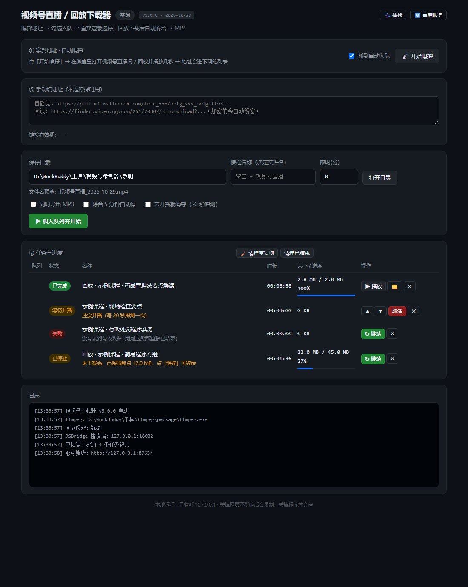

# 视频号 / m3u8 下载器

一个跑在本机的下载工具，两条产线共用一个网页：**视频号**（微信 Channels）直播录制 + 回放下载，
以及**任意 HLS / m3u8 地址**的探测与下载。浏览器打开一个本地网页操作，不用敲命令。

**直播**边拉边存，断流自动重连；**回放**下载后自动解密（视频号回放的 MP4 前 128 KB 被逐字节加密），解出来的文件可以直接播放。

> 只监听 `127.0.0.1`，不上传任何数据；所有文件都落在你选的本地目录。



---

## 功能

| 模块 | 能力 |
|---|---|
| **直播录制** | FLV 边拉边写、断流自动重连（跳过服务端重发的 13 字节 FLV 头）、录完自动转封装 MP4 |
| **回放下载** | HTTP Range 分块下载、断点续传（`.part` 保留）、自动解密、抽封面、导出 MP3 |
| **地址嗅探** | 一键接管系统代理（只解密视频号页面与直播 CDN），从页面里把地址捞出来；直播和回放都能抓 |
| **任务队列** | 串行执行、可排序（上移/下移/置顶/置底）、**全部暂停 / 全部恢复**（保留原顺序）、自动接续下一个、任务列表持久化 |
| **自动停止** | 到达设定时长 / 推流结束 / 静音超过 5 分钟 / 超时无数据，四种触发 |
| **开播蹲守** | 地址还没开播也没关系，20 秒探测一次，能拉流就自动开录。等待期间会**让出队首**，不会把后面的任务堵住 |
| **命名** | 默认就用课程名（不挂日期，名字不至于长到看不清）；需要时勾「文件名加日期」追加当天日期；名称可随时改，文件名实时预览 |
| **排序 / 筛选** | 点表头按**时间 / 名称 / 大小**排序；按体积下限筛；**默认只留正在播放的那条**，侧栏推荐自动过滤 |
| **运维** | 环境体检、错误提示、一键重启服务、清理重复项、打开文件/文件夹 |
| **m3u8 下载** | 粘地址即下（底层走 `N_m3u8DL-RE`）；先探测再下载、AES-128/SAMPLE-AES 自动取密钥解密、UA/Referer 防盗链自动补齐、参数可视化 |

---

## 快速开始

### 1. 依赖

| 依赖 | 用途 | 必需 |
|---|---|---|
| Python 3.8+ | 主程序（**只用标准库**，不需要 pip install 任何东西） | ✅ |
| [ffmpeg](https://www.gyan.dev/ffmpeg/builds/) | FLV→MP4 转封装、导出 MP3、抽封面 | ✅ |
| [Node.js](https://nodejs.org/) | 回放解密（加载官方 wasm） | 下回放才需要 |
| [mitmproxy](https://mitmproxy.org/) 的 `mitmdump` | 地址嗅探 | 用嗅探才需要 |

ffmpeg / node / mitmdump 都不需要装进 PATH，在 `config.json` 里写绝对路径即可：

```json
{
  "ffmpeg": "D:\\tools\\ffmpeg\\bin\\ffmpeg.exe",
  "mitmdump": "D:\\tools\\mitmproxy\\mitmdump.exe"
}
```

程序启动时会自己找：先看 `config.json`，再找常见安装位置和 PATH。缺什么，页面右上角「🩺 体检」会直接告诉你。

### 2. 启动

```bash
# Windows
双击 启动录制器.bat

# 或者命令行
python wxlive_recorder.py
```

会打开 <http://127.0.0.1:8766/>。

端口说明：默认 **8766**（v5.7.1 起，原先 8765 与服务台里的澄文扫描台撞车）。
被占用时启动日志会写明是哪个进程占的；需要临时换端口可设环境变量
`WX_UI_PORT=8770`，再启动本工具。

```bash
python wxlive_recorder.py --no-browser    # 不自动开浏览器
python wxlive_recorder.py --version       # 看版本
python wxlive_recorder.py --cli <URL> 60  # 纯命令行录 60 秒
```

### 3. 用起来

**路线 A：自动嗅探**（推荐）

1. 点「📡 开始嗅探」——它会临时把你系统的 HTTP 代理指向本机的 mitmproxy
2. 在微信里打开视频号直播间或回放，**并且真的点播放**
3. 只有**正在播放的那条**会出现在「② 嗅探结果」里（侧栏推荐默认自动过滤）；勾选 →「批量入队」
4. 用完点「■ 停止嗅探」，系统代理会自动还原

> 想看看被挡掉了什么，点筛选栏的「显示全部」；不勾「只看正在播放的视频」就恢复原样。

**路线 B：手动粘地址**

把 `.flv` 直播地址或回放地址粘进「③ 手动填地址」，点「加入队列并开始」。
程序会按地址自动判断：FLV 走录制，其余（回放 mp4）走下载 + 解密。

---

## m3u8 / HLS 下载（第二个标签页）

页面顶部有两个标签页：「视频号 直播 / 回放」和「m3u8 / HLS 下载」。后者给**普通 HLS 地址**用，
底层调本机的 `N_m3u8DL-RE.exe`；找不到它时页面上会有提示，把 exe 的完整路径填进「程序路径」点「检测」即可。

**用起来三步**：粘地址 → 点「检测地址」 → 点「开始下载」。地址后面的 `?auth_key=...` 要整段一起粘，少一个参数就是 403。

**为什么建议先「检测」**：很多站点的 CDN 有防盗链，直接把地址丢给下载器只会得到一句 `403 Forbidden`。
检测会先把播放列表抓一遍，告诉你：

- 多少切片、多长、是不是多码率（多码率会给最高画质那一路的详情）
- 加密方式（`AES-128` / `SAMPLE-AES` / 没加密）和密钥接口的域名
- 403 到底是**谁**拦的：`denied by Referer ACL`（缺 Referer）、`denied by UA ACL`（UA 被拉黑）、
  `invalid md5hash` / `req auth`（auth_key 过期或签名被改）

**防盗链自动补齐**：Referer 留空时，会先按地址同域 `https://<域名>/` 自动试一次；成功了就把这个值回填进输入框，
失败了把真实原因写在提示里。

**关于「自动解密」**：HLS 的 AES-128 密钥藏在播放列表的 `#EXT-X-KEY` 里，`N_m3u8DL-RE` 会自己按那个 URI
去取再解，`-H` 传的请求头也会一起带给取密钥的请求，一般不用管。只有密钥接口要登录态、要 POST 的时候，
才需要在「手动密钥」里填 32 位 hex 或 `KID:KEY`。

**可调参数**（都对应真实命令行开关，不是摆设）：

| 界面项 | 开关 | 说明 |
|---|---|---|
| 下载线程 | `--thread-count` | 单个文件的分片下载线程数，默认 20 |
| 失败重试 | `--download-retry-count` | 分片失败重试次数，默认 3 |
| 超时 | `--http-request-timeout` | 单次 HTTP 请求超时（秒），默认 100 |
| 限速 | `-R` | 如 `15M` / `500K`，留空不限 |
| 格式 | `-M format=` | `mp4` / `mkv` / `ts` |
| 自动选最高画质 | `--auto-select` | 多码率时不用手动挑 |
| 分片并发 | `-mt` | 音轨/视频/字幕同时下 |
| 删临时文件 | `--del-after-done` | 下完删掉分片 |
| 不合并 | `--skip-merge` | 只下不并，得到一堆 `.ts` |
| 走系统代理 | `--use-system-proxy` | 嗅探开着时建议关掉，直连更快 |
| 额外命令行参数 | — | 上面没覆盖的开关手写，比如 `--custom-hls-method AES_128` |

**注意**：

- 下载任务只在内存里，**重启服务会中断正在跑的下载**（子进程会按 PID 收掉，不留孤儿进程）。
- 停止用的是 `taskkill /F /T /PID`，只杀自己起的进程树 —— 你自己另外开着的 `N_m3u8DL-RE` 不受影响。
- 保存目录可以任选，下完「打开 / 播放」都能用（该目录会自动进 `/api/open` 白名单）。

---

## 只想要命令行？

[`standalone/`](standalone/) 里放了两个不依赖网页界面的独立脚本：

- `video_rec.py`：ffmpeg 直接转封装为分片 MP4，支持限时录制。
- `record_live.sh`：纯 curl 拉流，断流自动重连续录为 FLV。

用法、依赖和回归测试见 [standalone/README.md](standalone/README.md)。

---

## 工作原理

### 直播：FLV over HTTP

视频号直播就是一个带签名的 FLV 长连接：

```
https://pull-m1.wxlivecdn.com/trtc_xxx/orig_xxx_orig.flv?txSecret=...&txTime=6AE401F7
```

- `txTime` 是十六进制的过期时间戳，`txSecret` 是配套签名，**不需要登录态**
- 服务端关连接是常态（切片、负载均衡），所以必须重连
- **重连时服务端会先重发一遍 13 字节的 FLV 文件头**（`FLV` + 版本 + 标志 + 头长度 + `PreviousTagSize0`），这一段必须丢掉，否则在文件中间插一个头会让时间戳错乱
- 录完用 `ffmpeg -c copy` 转封装成 MP4，`+faststart` 让网页能边下边播

### 回放：前 128 KB 被加密

回放是普通 MP4，但**文件头被加密了**，直接下载打不开：

| 项目 | 值 |
|---|---|
| 加密算法 | Isaac64 PRNG 生成密钥流，逐字节 XOR |
| 加密范围 | **只有前 131072 字节（128 KB）**，后面全是明文 |
| 密钥 | 接口里的 `decode_key`（十进制整数），**密钥流需要整体 `reverse()`** |
| 校验 | 解密后 `offset 4` 必须是 `ftyp` |
| 自证 | 0–128 KB 的熵是 7.95（接近随机），跨过 131072 掉到 1.80 |

服务端会通过 `X-encflag: 1` / `X-enclen: 131072` 明确告诉你这两个参数，和熵扫描的结果完全一致。

解密用的是**微信自己的 `wasm_video_decode.wasm`**（在 `_bin/wvd.wasm`），通过 Node 加载、注入 `wasm_isaac_generate(ptr,len)` 把密钥流抓出来。
**不自己实现 Isaac64** 是有意的：只要有一个字节和播放器不一致，解出来的文件就废了。

### decode_key 为什么抓不到 HTTP 包

回放的 `decode_key`、标题、作者、文件大小**根本不在 HTTP 报文里**。

页面是通过 `WeixinJSBridge.invoke('finderH5ExtTransfer', {...}, cb)` 向**微信原生层**要的，走的是 WebView 内部通道，网络层完全看不见。所以只能：

1. mitmproxy 改写 `channels.weixin.qq.com` 的 HTML，注入一段钩子
2. 钩子替换 `WeixinJSBridge.invoke`，把参数和回调结果 `POST` 到本机的接收端
3. 接收端递归挖出 `url` + `decode_key`，落盘成 `sniffed.jsonl`

三个必须踩过的坑：

- **`resp_json` 是 JSON 字符串，不是对象**。微信把真正的响应塞在这个字段里，值本身又是一段 JSON，得再 `json.loads` 一次才能挖进去
- **`url` 只有半截**。签名参数全在 `url_token` 里，`url + url_token` 拼起来（约 966 字符）才能拿到 206，否则一律 400
- **注入要等 `load` 之后**。在 `<head>` 里立即 hook 会抢在页面初始化之前，直接白屏

### 关于去重

同一个回放每请求一次就换一套 `svrnonce` → `url` 和 `decode_key` 每次都不同，**按 URL 去重等于没去重**。
所以按「**标题 + 文件大小**」认人，重复出现时只把地址刷新成最新的那份（旧 token 可能已过期）。

### 怎么认出"正在播放的那个"

回放页右侧有推荐列表。页面打开时，会把**整屏列表里每个视频**的播放信息都通过 JSBridge 拿一遍 ——
每个都带 `url` + `decode_key`，结构和"当前播放的那个"一模一样，光看响应分不出来。

真正的判据在**播放进度上报**里。播放器每 10 秒会给正在播的那个视频发一次弹幕轮询：

```
cgi = /cgi-bin/micromsg-bin/pc_findergetbulletcomment
req_json = {"finder_basereq":{...},
            "object_id":"15032073723187175035",     ← 哪个视频
            "start_timestamp":"30000"}             ← 播到第 30 秒
```

换一个视频，`start_timestamp` 从 0 重新开始 —— 这就是"此刻在播"的铁证。
侧栏推荐只在列表渲染时批量取过一次信息，永远不会有这种周期性上报。

所以：

- `bridge_server` 把每次播放进度按 `object_id` 记进 `playing.jsonl`
- 侧栏推荐和播放页视频共用同一个 `object_id` 字段（挂在 `object.id` 上，比 `url` 的爷爷层）
- 两边一对，**播过的留下、没播过的自动过滤**，`sniffer.status()` 直接把过滤做在服务端
  （顺带省掉每秒钟几十 KB 的 URL 传输）

> 三个例外不会误伤：直播流（房间里只有一路，没有侧栏）、老版本抓到的没有 `object_id` 的记录、
> 以及关掉开关后的全部结果。

> 必须**真的点播放**才会被认出来。只打开页面不点播放，界面上会提示"抓到了 N 条，但都不是正在播放的视频"。

---

## 目录结构

```
.
├── wxlive_recorder.py    主程序：任务调度 + HTTP API + 录制/下载线程
├── ui.py                 前端页面（单文件 HTML/CSS/JS）
├── hlsdl.py              m3u8 下载模块：封装 N_m3u8DL-RE（探测 / 队列 / 进度 / 收尾）
├── sniffer.py            嗅探器：系统代理接管、mitmdump 管理、结果收集
├── capture_addon.py      mitmproxy 插件：抓流地址、注入 JSBridge 钩子
├── bridge_server.py      JSBridge 接收端（注入脚本往这里回传数据）
├── wxdecrypt.py          解密封装（调 _bin/wxdec.js）
├── _bin/
│   ├── wxdec.js          Node 脚本：加载 wasm 生成密钥流 / 解密
│   └── wvd.wasm          微信官方播放器的解码模块
├── standalone/           不依赖网页界面的独立命令行录制脚本
├── 启动录制器.bat
└── 录制/                 默认输出目录
```

---

## 版本记录

### v5.7.2（2026-11-02）界面重排与命名收口

- 视频号页卡片顺序改为：①自动嗅探 → ②嗅探结果 → ③任务与进度 → ④日志 → 保存设置 → 手动填地址（置底）。
- 「▶ 加入队列并开始」只保留在手动填地址卡片里；保存设置卡不再放启动按钮。
- 入队提示区分三种情况：「正在开始录制」「#N 结束后自动开始」「开播后自动开始」，不再一律回「已加入队列」。
- **「文件名加日期」同时作用于任务名**：此前只有磁盘上的文件名带日期，任务列表里看不出来，像是没生效。
- 名称输入框去重：嗅探结果逐行改名；手动填地址用卡片内的名称；保存设置里重复的「课程名称」已移除。
- **页面模板热加载**：改完 `ui.py` 刷新浏览器就能看到，不必重启服务（录制线程在本进程内，重启会中断录制）。

### v5.7.0（2026-11-02）新增 m3u8 / HLS 下载标签页

- 新增 `hlsdl.py`：封装 `N_m3u8DL-RE`，负责地址探测、串行队列、实时进度和按 PID 收尾。
- 页面改为双标签页（视频号 / m3u8），支持 `?tab=hls` 直达；标题与副标题随标签切换。
- **探测先行**：把 Tengine 的 `denied by Referer ACL`、`denied by UA ACL`、`invalid md5hash` 翻译成可执行的修复建议。
- **防盗链自动补齐**：Referer 留空时自动用同域地址重试一次，成功后回填输入框。
- **进度解析修复**：该工具输出被重定向到管道时**不写换行符**，整条进度条挤成一行，按 `\r\n` 切永远切不出来、进度恒为 0；
  改为按行首时间戳与进度条标签切段，顺带修掉了「自动开启二进制合并」这句日志把状态误判成「已完成」的问题。
- 失败时反查真实原因，不再只抛 `403 (Forbidden)` 的英文栈。
- `/api/open` 白名单纳入 m3u8 的输出目录；环境体检新增 `N_m3u8DL-RE` 一项。
- 退出 / 重启时先收掉下载子进程，避免留下孤儿进程占着文件。

### v5.6.0（2026-11-01）稳定性与安全审计

详细审计、风险与验证步骤见 [docs/AUDIT_v5.6.0.md](docs/AUDIT_v5.6.0.md)。
- **单实例保护**：先确认端口和实例，再加载任务、启动调度；第二个进程只复用已有服务，不再换端口起双实例写坏录像。
- **任务持久化**：`tasks.json` 改为唯一临时文件 + 原子替换，自动保留 `.bak`；主文件损坏或单条记录异常时跳过/回滚，不再整表消失或启动崩溃。
- **状态机修复**：停止正在退出的任务不再泄漏 `active`；取消与启动原子化，避免“界面已取消、后台还在录”。
- **断点续传**：HTTP 416 时识别“文件已完整”或安全清零重下；重试按“连续无进展”计数，403/404 不再无意义重试。
- **本机接口防护**：校验 Host 与固定端口 Origin，阻断 DNS rebinding 和 `localhost:其它端口` 的调用；`/api/open` 只允许媒体/图片类型，并解析符号链接。
- **Bridge 防护**：只接受 `https://channels.weixin.qq.com` 的写入，CORS 不再使用 `*`，增加请求超时和端口占用保护。
- **文件名与收尾**：清理控制字符、正确处理 `COM1.txt` 等 Windows 保留名；解密先写 `.part`，失败不留半截成品 MP4。
- **嗅探范围**：在仅解密视频号页面的基础上恢复 `*.wxlivecdn.com`，修复直播地址嗅探静默失效；仍不使用全量 TLS 解密。

---

## 常见问题

**Q：点了「开始嗅探」，其他网站打不开了？**
程序只对 `channels.weixin.qq.com` 和 `*.wxlivecdn.com` 做 TLS 解密，其它域名原样隧道转发，正常情况下不受影响。
如果反而打不开，多半是别的抓包工具（同类的视频号下载器）还占着系统代理 —— 先把它的「开始监听」关掉。

**Q：嗅探结果里一堆同一个视频？**
程序已按「标题 + 大小」自动去重。历史遗留的重复可以点「🧹 清理重复」。

**Q：嗅探结果里一堆我没点开的视频？**
默认已经挡掉了 —— 认的是"播放器有没有为它上报播放进度"，侧栏推荐不会有。
真要全部看一遍，点筛选栏的「显示全部」，它们会标上「侧栏」。

**Q：列表是空的，只说「已自动过滤 N 条侧栏推荐」？**
说明播放器还没开始播。让它播两三秒再看；只是打开了页面没点播放，就不会有播放进度上报。
点「显示全部」可以先看全部结果。

**Q：播放的时候切了好几个视频，会越攒越多吗？**
会留下你**播过的**那几个（方便回头再下前一个），但每个都只有一条。
只有最新那个标「▶ 正在播放」，更早的标「▶ 播过」。

**Q：回放下载完了但打不开？**
看日志里有没有「解密完成」。如果报「没抓到 decode_key」，说明注入没生效：
在微信里**重新打开一次**回放页面（旧页面可能还挂着注入前的 JS）。

**Q：地址过几小时就不能用了？**
直播地址带 `txTime` 签名，回放地址带 token，都有时效。失效就重新嗅探一次。
任务列表不会丢（存在 `tasks.json`），重新抓到的地址会生成新任务。

**Q：能不能后台跑，关掉网页？**
可以。关网页不影响录制；关掉程序（或电脑睡眠）才会停。
重启程序后任务列表会自动恢复，**包括还在蹲守的任务**，中断的下载点「↻ 继续」可以接着下。

**Q：同一个回放下载失败了，再点一次「入队下载」没反应？**
v5.5 之前确实会这样：建任务时把「已完成 / 失败 / 已停止」的旧任务也当成"已经有了"，
直接返回它，于是什么都不会发生。现在只有**还在跑或还排着**的任务才会被复用，
终态任务一律新建 —— 再点一次就是重新下一份（文件名自动加 `(2)`）。

**Q：换个保存目录后「打开目录」打不开？**
目录一律放行（文件仍然受白名单保护）。如果还是没反应，看页面右下角有没有红色提示。

---

## 已知限制

- 只支持 Windows（用了 `os.startfile`、`winreg`、`taskkill` 这些 Windows 专有接口）
- 嗅探必须走 mitmproxy，**需要系统信任 mitmproxy 的根证书**（`%USERPROFILE%\.mitmproxy\mitmproxy-ca.pem`）。第一次用别的抓包工具时通常会提示安装
- 静音检测是**另外拉一路音频流**用 ffmpeg 的 `silencedetect` 判断，会多占一点带宽
- 视频号改版可能让注入失效（钩子挂在 `WeixinJSBridge.invoke` 上）。真失效了看 `_debug/` 里 dump 的原始响应结构再调

---

## 免责声明

本项目仅供**个人学习、技术研究与备份自己有权访问的内容**使用。

- 请遵守《著作权法》《网络安全法》及微信平台的服务条款
- **不要**用它录制他人明确禁止录制的内容，不要传播、二次分发他人的课程、讲座、直播
- 录制他人肖像、声音可能涉及《民法典》《个人信息保护法》相关规定，请自行评估合规性
- 使用本工具产生的一切后果由使用者自负

如果权利人认为本项目侵犯其权益，请提 issue，会立即处理。

---

## 致谢

- [mitmproxy](https://mitmproxy.org/) —— TLS 中间人与注入的基础
- [qiye45/wechatVideoDownload](https://github.com/qiye45/wechatVideoDownload) —— 回放加密方案的早期探索给了很多启发
- [ffmpeg](https://ffmpeg.org/) —— 转封装、音频、封面

## License

[MIT](LICENSE)
